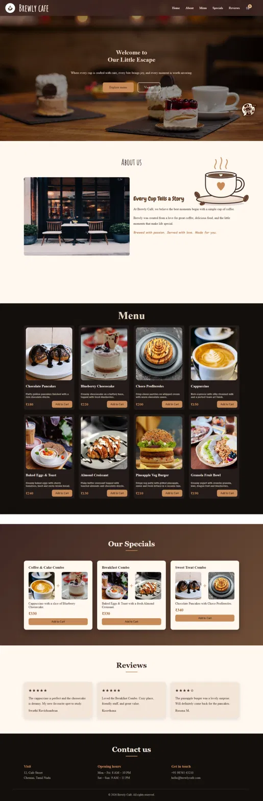

# Brewly Cafe

A responsive café website built with React and Vite.

**Live demo:** (https://brewly-cafe-myn9.vercel.app/)

## Features
- Menu with 8 items, rendered from a data array
- Combo offers in a Specials section
- Shopping cart with live item count and total
- Simple rule-based chatbot
- Responsive layout with CSS Grid and Flexbox

## Tech
React, Vite, JavaScript, CSS

## Run locally
npm install
npm run dev

## Credits
Food photos from Pexels and Freepik. Reviews, address and phone number are sample content.